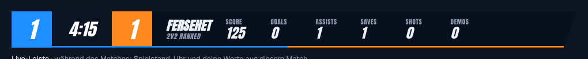
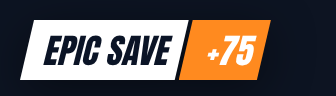
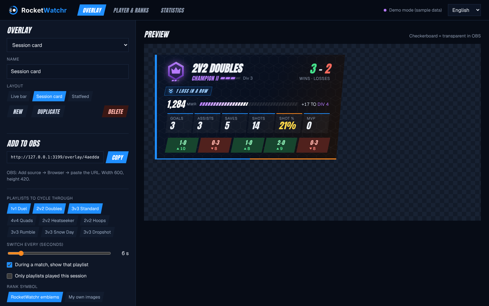
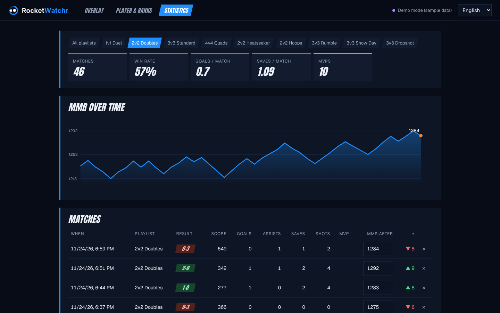

<h1>
  <picture>
    <source media="(prefers-color-scheme: dark)" srcset="public/logo-animated.svg">
    
  </picture>
</h1>

Show your **Rocket League** stats in your OBS stream: the live score and your numbers during a match, a session card with your record in every ranked playlist, and a short pop-up for goals, saves and demos. You host it yourself, design the overlay in the editor, and OBS shows it as a browser source.

<p align="center">
  
</p>

- Three layouts: a **Live bar** during the match, a **Session card** and a **Statfeed** pop-up
- The session card switches through your ranked playlists (Duel, Doubles, Standard, Quads, Heatseeker, Hoops, Rumble, Snow Day, Dropshot). You pick which ones and how long each one stays; during a match it shows the playlist you are playing
- Your MMR per playlist with a bar that shows how many points are left to the next division or rank
- Win and loss streaks, totals and your last five results per playlist with the MMR won or lost in each game, counted from the start of your stream
- Rank symbols in the Watchr style, or your own images if you prefer
- An editor in your browser with a live preview, protected by a login if you set a password, and every change shows up in OBS right away
- A **Statistics** page with every match, your win rate, goals and saves per match, MVPs and your MMR over time, saved on your server
- Editor and overlay in English, German, Russian and French
- Data from the official Rocket League Stats API on your own PC: no account, no third-party server

## What it looks like

**Live bar:** the score, the clock and your score, goals, assists, saves, shots and demos in the current match.



**Statfeed:** a short pop-up for goals, saves, epic saves, demos, hat tricks and MVP.

<p align="center"></p>

**Editor:** pick a layout, the playlists, colours, size and language, and copy the OBS link. The preview follows every change right away.



**Statistics:** every match with result, score, goals, assists, saves, shots and MVP. Type in your MMR after a match and the card shows what you won or lost.



The screenshots show sample data.

## Requirements

- [Node.js](https://nodejs.org) 22.18 or newer (RocketWatchr has no other dependencies)
- Rocket League on the same PC, with the Stats API switched on (see below)

## Setup and start

```bash
git clone https://github.com/Fersehet/RocketWatchr.git
cd RocketWatchr
cp .env.example .env   # Windows: copy .env.example .env
npm start
```

Open **http://localhost:3100**. Without a password in `.env` the editor opens right away and only this PC can reach it. To protect it (for example, if the server also runs for your home network), set one:

```env
ADMIN_PASSWORD=a-long-password
```

Then sign in with user `admin` and your password.

To try everything without the game, start the demo: `npm run demo`. It plays endless 2v2 matches with sample data and saves nothing.

## Switch on the Stats API in Rocket League

The game only sends match data when you allow it:

1. Close Rocket League.
2. In the Rocket League install folder, open `TAGame\Config\TAStatsAPI.ini` (or `DefaultStatsAPI.ini` if the first one does not exist).
3. In the section `[TAGame.MatchStatsExporter_TA]`, set `PacketSendRate` to a value above 0, for example `PacketSendRate=30` (0 switches it off, 120 is the maximum). Leave `Port=49123`.
4. Start Rocket League. The status in the editor changes to **Connected to Rocket League** as soon as a match is running.

## Add to OBS

1. In the editor, pick an overlay and click **Copy** next to the link.
2. In OBS: **Add source → Browser**, paste the link and set the width and height the editor shows (live bar 1000 × 80, session card 600 × 420, statfeed 600 × 90).

Every change in the editor shows up in OBS right away. Make one overlay per layout, or several with different playlists.

## Rank and MMR

Rocket League does not share rank or MMR with other programs (see below), so you enter them once on the **Player & ranks** page: rank, division and MMR per playlist, and if you like the MMR where your division starts and where the next one starts, for the progress bar. After a match, type the new MMR on the **Statistics** page; RocketWatchr saves the change for that match and updates the playlist.

On the same page you set your in-game name. If you leave it empty, RocketWatchr uses the player the game camera follows while you play.

**Rank symbols:** RocketWatchr draws its own emblems. To use your own images instead, put them in `data/ranks` (for example `champion-2.png`, `grand-champion-1.png`, `supersonic-legend.png`) and pick **My own images** in the editor.

## Where the data comes from

Rocket League has an official Stats API that sends match data from the game to your own PC while a match is running. RocketWatchr reads it, so it needs no login and no API key.

- **Per player:** score, goals, shots, assists, saves, touches and demos
- **Per match:** score, clock, overtime, arena and winner
- **Events:** goals, stat events such as saves and demos, and the end of the match

The API does not include your **rank or MMR**, and there is no other official interface for them, so you enter them in the editor. Boost and speed are only sent while spectating, not for your own car.

The API only sends a number for the playlist. RocketWatchr knows the numbers of the usual ranked playlists; if one shows up as unknown, assign it on the **Player & ranks** page.

Matches, ranks and overlays are saved in `data/rocketwatchr.db` on your PC.

## License

[MIT](LICENSE)
