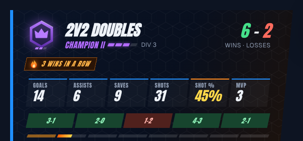

<h1>
  <picture>
    <source media="(prefers-color-scheme: dark)" srcset="public/logo-animated.svg">
    
  </picture>
</h1>

Show your **Rocket League** stats in your OBS stream: the live score and your numbers during a match, a session card with your record in every ranked playlist, and a short pop-up for goals, saves and demos. You host it yourself, design the overlay in the editor, and OBS shows it as a browser source.

> **In development.** The layouts below are the design. The server, the editor and the setup are being built, so there is nothing to install yet.

  

- Three layouts: a **Live bar** during the match, a **Session card** and a **Statfeed** pop-up
- The session card switches through your ranked playlists (Duel, Doubles, Standard, Heatseeker, Hoops, Rumble, Snow Day, Dropshot). You pick which ones and how long each one stays
- Win and loss streaks, totals and your last five results per playlist, counted from the start of your stream
- Rank symbols in the Watchr style, or your own images if you prefer
- An editor in your browser with a live preview, protected by a login, and a **Statistics** page with your matches, saved on your server
- Data from the official Rocket League Stats API on your own PC: no account, no third-party server

## What it looks like

**Live bar:** the score, the clock and your score, goals, assists, saves, shots and demos in the current match.

**Statfeed:** a short pop-up for goals, saves, epic saves, demos, hat tricks and MVP.

The screenshots show sample data.

## Where the data comes from

Rocket League has an official Stats API that sends match data from the game to your own PC while a match is running. RocketWatchr reads it, so it needs no login and no API key.

- **Per player:** score, goals, shots, assists, saves, touches and demos
- **Per match:** score, clock, overtime, arena and winner
- **Events:** goals, stat events such as saves and demos, and the end of the match

The API does not include your **rank or MMR**. You set your rank per playlist in the editor. Boost and speed are only sent while spectating, not for your own car.

## License

[MIT](LICENSE)
